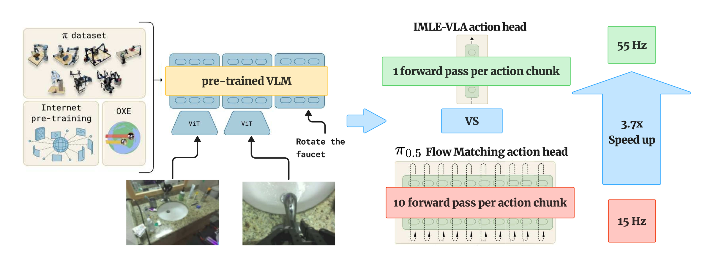

<div align="center">

# IMLE-VLA: Fast Single-Step Action Generation for Vision-Language-Action Policies

[](https://arxiv.org/abs/2609.10915)
[](https://kianhk6.github.io/IMLE-VLA/)
[](https://kianhk6.github.io/IMLE-VLA/)
[](LICENSE)

**Kian Hosseinkhani**<sup>1*</sup>, Qinhe Peng<sup>2</sup>, George Shramko<sup>1</sup>, Mehran Aghabozorgi<sup>1</sup>, Jianing Qian<sup>2</sup>,
Tristan Engst<sup>1</sup>, Alireza Moazeni<sup>1</sup>, Dinesh Jayaraman<sup>2</sup>, Ke Li<sup>1,3,4</sup>

<sup>1</sup>Simon Fraser University &nbsp;·&nbsp; <sup>2</sup>University of Pennsylvania &nbsp;·&nbsp; <sup>3</sup>Amii &nbsp;·&nbsp; <sup>4</sup>Canada CIFAR AI Chair



</div>

IMLE-VLA replaces the iterative flow-matching action head of a vision-language-action (VLA) policy with a **single-step
conditional generator** trained with **conditional Implicit Maximum Likelihood Estimation (cIMLE)**. The pretrained
vision-language model (VLM) backbone is frozen and unchanged. One forward pass of the action expert produces a full action
chunk, instead of the 10 Euler steps that π₀.₅ needs. The cIMLE objective keeps the multimodal action distribution, so the
policy does not collapse to a mean action the way a plain regression head does.

Applied to π₀.₅ (numbers from the paper):

| | π₀.₅ (JAX) | **IMLE-VLA** |
|---|---|---|
| Inference frequency, NVIDIA L40S, 2 camera views | 15 Hz | **55 Hz (3.67×)** |
| LIBERO average success, 40 tasks, H = 10 | 97.5 % | **98.0 %** |
| Action throughput, H = 30 vs. H = 10 | 1× | **11×** |
| Real robot, VLA wall-clock per episode | 1× | **3.9×–6.6× lower** |
| Real robot, proprioceptive jerk | 1× | **2.2×–3.0× lower** |

This repository is a fork of Physical Intelligence's [openpi](https://github.com/Physical-Intelligence/openpi). Everything
that openpi can do (π₀, π₀-FAST, π₀.₅, ALOHA / DROID / LIBERO examples, PyTorch port) still works. The sections below
describe only what IMLE-VLA adds. Real-robot videos are on the [project page](https://kianhk6.github.io/IMLE-VLA/).

## News

- **2026-10** Code release.
- **2026-09** Paper on [arXiv](https://arxiv.org/abs/2609.10915). IMLE-VLA is accepted at IROS 2026.

## What this repository adds to openpi

| Path | What |
|---|---|
| `src/openpi/models/pi0.py` | `_compute_loss_imle`: the cIMLE objective (Algorithm 1 of the paper). `_sample_actions_imle`: single-step sampling that reuses the prefix KV cache. |
| `src/openpi/models/pi0_config.py` | Two new fields: `use_imle` and `imle_k` (the cIMLE sample factor *m*). |
| `scripts/train.py` | IMLE metrics (`imle_first_dist`, `imle_min_dist_first5`), learning-rate logging, config dump, fast resume for RLDS data. |
| `src/openpi/training/config.py` | The paper configs `16_horrizon_05_lr_2_factor_96_batch` (DROID) and `libero_50_action_05_lr_005_min_2_factor_correct` (LIBERO), plus the exploratory `*imle*` configs used during development. |
| `scripts/serve_policy.py` | `policy:checkpoint` serves an IMLE checkpoint with `--policy.sample-kwargs='{"num_steps": 1}'`. New `policy:triton-checkpoint` serves a converted `.pkl` through the Triton engine with the same transform pipeline as JAX. |
| `realtime-vla-imle/` | The single-step Triton inference engine (`Pi05InferenceIMLE`), CUDA-graph captured. This is the 55 Hz path. Derived from Dexmal's [realtime-vla](https://github.com/dexmal/realtime-vla). |
| `realtime-vla/` | Vendored flow-matching Triton engine (the "Triton" baseline row) and the JAX → `.pkl` converter `convert_from_jax_pi05.py`. |
| `scripts/serve_triton.sh` | One-command server for a Triton package. |
| `scripts/merge_all_lora.py` | Folds LoRA factors into the base weights. Required before converting a LoRA fine-tune to Triton. |
| `scripts/validate_triton_droid.py` | Triton-vs-JAX parity check on DROID samples. |
| `examples/libero/main.py` | `--n-action-steps` is the execution horizon *H*. Reports per-call inference time (VLA-only wall-clock). |
| `examples/libero/eval_triton_imle.py`, `eval_triton.py` | Direct LIBERO evaluation with the Triton engines, no server. See `examples/libero/README_TRITON.md`. |
| `examples/droid/main.py`, `examples/jerk_metric.py` | DROID robot client with the proprioceptive-jerk metric used in the paper. |
| `environment.yml` | Exact conda export of the environment used for the paper's experiments. |

Everything else is unchanged upstream openpi at commit `86b6dee`.

## Installation

Tested on Ubuntu 22.04 with Python 3.11, CUDA 12, JAX 0.5.3, PyTorch 2.7.1 and Triton 3.3.1 (NVIDIA L40S, A6000, H100).

```bash
git clone --recurse-submodules https://github.com/kianhk6/IMLE-VLA.git
cd IMLE-VLA

conda create -n imle-vla python=3.11 -y
conda activate imle-vla
pip install -e packages/openpi-client
pip install -e .              # JAX + PyTorch + Triton stack (pins in pyproject.toml)
pip install -e ".[rlds]"      # only for DROID RLDS training (tensorflow-cpu, dlimp)
```

`environment.yml` is the exact export of the environment we used. `conda env create -f environment.yml` reproduces it.

Checkpoints and assets from `gs://openpi-assets` download automatically on first use and are cached in `~/.cache/openpi`
(override with `OPENPI_DATA_HOME`). The PaliGemma SentencePiece tokenizer is cached in the same place.

For the LIBERO simulator follow [`examples/libero/README.md`](examples/libero/README.md). It needs the `third_party/libero`
submodule and its own Python environment.

## Checkpoints

The checkpoints are available on request. Email **kian_hosseinkhani@sfu.ca** with the model you need and we will share a
download link. Each JAX checkpoint comes as a `<step>/` directory with `params/` and `assets/`; the Triton packages come
in the layout described under [Fast inference with Triton](#fast-inference-with-triton-55-hz).

| Model | Fine-tuned from | Data | Config | Format |
|---|---|---|---|---|
| IMLE-VLA DROID (real robot) | `pi05_droid` | DROID, joint-position actions, 16-step chunks | `16_horrizon_05_lr_2_factor_96_batch` | JAX checkpoint, Triton package |
| IMLE-VLA LIBERO | `pi05_libero` | LIBERO (4 suites), 50-step chunks | `libero_50_action_05_lr_005_min_2_factor_correct` | JAX checkpoint, Triton package |

## Training with cIMLE

cIMLE needs two fields on `Pi0Config`:

```python
pi0_config.Pi0Config(pi05=True, use_imle=True, imle_k=2, ...)
```

- `use_imle=True` switches the loss to cIMLE and the sampler to one forward pass.
- `imle_k` is the sample factor *m*. For each training example the model draws *m* noise vectors, generates *m* candidate
  chunks without gradient, keeps the candidate closest (L2) to the ground truth, and re-runs only that one with gradient.
  `imle_k=1` is plain L2 regression. The paper uses `imle_k=2`; `imle_k=5` gives the same success at higher cost.
- The VLM prefix is computed once per example and repeated *m* times, so the extra cost is *m* passes of the small action
  expert. Memory grows with *m*.
- The VLM is frozen (`frozen=["paligemma"]`). Only the action expert is trained, starting from a π₀.₅ checkpoint.

### DROID (the real-robot model)

The config `16_horrizon_05_lr_2_factor_96_batch` is the run behind the real-robot results: frozen VLM, `imle_k=2`,
16-step chunks, joint-position action space, batch 96, cosine schedule with peak LR 1.75e-5, EMA 0.99. It starts from
`gs://openpi-assets/checkpoints/pi05_droid` and reuses that checkpoint's DROID normalization statistics, so
`compute_norm_stats.py` is not needed.

1. Get the DROID RLDS dataset (see [`examples/droid/README_train.md`](examples/droid/README_train.md)).
2. Set `rlds_data_dir` in the config to the parent directory of your `droid` RLDS directory.
3. Launch:

```bash
XLA_PYTHON_CLIENT_MEM_FRACTION=0.9 python scripts/train.py 16_horrizon_05_lr_2_factor_96_batch \
    --exp-name=16_horrizon_05_lr_2_factor_96_batch \
    --checkpoint-base-dir=/path/to/checkpoints \
    --resume \
    --fsdp_devices 1
```

- Checkpoints land in `/path/to/checkpoints/<config>/<exp-name>/<step>/` with `params/` and `assets/` inside.
- `--resume` lets the same command restart from the latest checkpoint after a preemption. On the first launch it starts fresh.
- `--fsdp_devices 1` is pure data parallelism over the visible GPUs. The paper run used 4 GPUs (24 samples each).
  Raise it to shard parameters when memory is tight.
- The training log and Weights & Biases show `loss` (the cIMLE nearest-neighbour L2), `imle_first_dist` (the distance a
  plain regression head would see) and `imle_min_dist_first5` (the distance after the assignment step).

### LIBERO

`libero_50_action_05_lr_005_min_2_factor_correct` carries the hyperparameters of the paper's LIBERO run: frozen VLM,
`imle_k=2`, 50-step chunks, batch 140, peak LR 1.25e-5, AdamW with weight decay 1e-2, EMA 0.999, 10k steps, initialized
from `gs://openpi-assets/checkpoints/pi05_libero`. The LeRobot dataset `physical-intelligence/libero` downloads on first use.

```bash
XLA_PYTHON_CLIENT_MEM_FRACTION=0.9 python scripts/train.py libero_50_action_05_lr_005_min_2_factor_correct \
    --exp-name=imle_libero --checkpoint-base-dir=/path/to/checkpoints --fsdp_devices 1
```

### Your own dataset

Follow openpi's recipe (convert to LeRobot, define a `DataConfigFactory`, run `scripts/compute_norm_stats.py`) and set
`use_imle=True, imle_k=2` in the model config. The `pi05_libero_imle_*` configs are small worked examples.

## Serving a policy (JAX)

The policy server and the clients are unchanged from openpi; only two flags matter for IMLE-VLA.

```bash
# DROID / real robot
python scripts/serve_policy.py --env=DROID --port=8000 policy:checkpoint \
    --policy.config=16_horrizon_05_lr_2_factor_96_batch \
    --policy.dir=/path/to/checkpoints/16_horrizon_05_lr_2_factor_96_batch/16_horrizon_05_lr_2_factor_96_batch/<step> \
    --policy.sample-kwargs='{"num_steps": 1}'

# LIBERO
python scripts/serve_policy.py --env=LIBERO --port=8000 policy:checkpoint \
    --policy.config=libero_50_action_05_lr_005_min_2_factor_correct \
    --policy.dir=/path/to/checkpoints/libero_50_action_05_lr_005_min_2_factor_correct/imle_libero/10000 \
    --policy.sample-kwargs='{"num_steps": 1}'
```

`num_steps=1` selects the single-step sampler. The configs above already set `use_imle=True`, so the server uses the IMLE
sampler for them in any case.

**Robot client.** Follow [`examples/droid/README.md`](examples/droid/README.md). The client in this repo adds the jerk
metric from the paper (per-episode and running averages, printed at every replan). The paper ran IMLE-VLA at
`--open_loop_horizon 12` (π₀.₅ used its default 8):

```bash
python examples/droid/main.py --remote_host=<server_ip> --remote_port=8000 --external_camera=left --open_loop_horizon 12
```

**LIBERO client.** This repo's `examples/libero/main.py` parses its arguments directly, so flags have no `--args.` prefix.
`--n-action-steps` is the execution horizon *H* (paper: 10 and 30; 50 trials per task):

```bash
python examples/libero/main.py --task-suite-name libero_10 --n-action-steps 10 --num-trials-per-task 50 --host 127.0.0.1 --port 8000
```

At the end the client prints the success rate per task and overall, the number of policy calls, and the total
inference time. That total is the VLA-only wall-clock (VLA-WC) metric of the paper.

## Fast inference with Triton (55 Hz)

The JAX server runs π₀.₅ flow matching at about 15 Hz. The 55 Hz number in the paper comes from running the IMLE head
with hand-written Triton kernels and CUDA graphs (`realtime-vla-imle/`). The weights are
exported once from the JAX checkpoint to a `.pkl`, then served by the same `scripts/serve_policy.py` so the clients do not
change. We ship each exported model as a self-contained **Triton package**:

```
<package>/
├── <name>.pkl                       # all weights for the realtime-vla-imle engine (≈6.7 GB, bfloat16)
├── assets/<asset_id>/norm_stats.json   # normalization statistics of the training run (asset_id: droid, physical-intelligence/libero)
├── paligemma_tokenizer.model        # optional: lets the server start offline
└── engine/                          # optional: provenance copy of realtime-vla-imle/*.py
```

### 1. (LoRA fine-tunes only) merge the LoRA factors

The engine runs plain fused einsums and the converter reads only the base weights, so LoRA factors must be folded
first. The paper's DROID and LIBERO configs train the full action expert and skip this step.

```bash
JAX_PLATFORMS=cpu python scripts/merge_all_lora.py /path/to/ckpt/<step>/params /path/to/ckpt/<step>_merged/params
cp -r /path/to/ckpt/<step>/assets /path/to/ckpt/<step>_merged/     # norm stats travel with the checkpoint
```

The script folds both LoRA families (VLM rank 16, action expert rank 32) and runs a functional check on every folded
site. It handles the head-sum trap of `attn_vec_einsum`, where the LoRA B factor must be summed over heads; a naive
per-head fold is silently wrong there.

### 2. Convert the JAX checkpoint to a `.pkl`

```bash
PKG=/path/to/imle_droid_triton
CKPT=/path/to/checkpoints/16_horrizon_05_lr_2_factor_96_batch/16_horrizon_05_lr_2_factor_96_batch/<step>
mkdir -p $PKG/assets/droid $PKG/engine

CUDA_VISIBLE_DEVICES=0 JAX_PLATFORMS=cpu python realtime-vla/convert_from_jax_pi05.py \
    --jax_path $CKPT \
    --output $PKG/imle_droid_triton.pkl \
    --prompt "<the task prompt>" \
    --tokenizer_path google/paligemma-3b-pt-224

cp $CKPT/assets/droid/norm_stats.json $PKG/assets/droid/
cp realtime-vla-imle/*.py $PKG/engine/
cp ~/.cache/openpi/big_vision/paligemma_tokenizer.model $PKG/
```

- `--jax_path` is the step directory that contains `params/`.
- The converter needs a GPU (`torch` tensors are built on CUDA). `JAX_PLATFORMS=cpu` keeps JAX off the GPU during the export.
- `--prompt` is stored in the `.pkl` as pre-computed language embeddings. π₀.₅ tokenizes the real prompt and the
  discretized state at every call (`discrete_state_input=True`), so the stored prompt is only a fallback; pass the task prompt.
- `--tokenizer_path` is a Hugging Face id or a local snapshot. `google/paligemma-3b-pt-224` is gated: accept the terms and
  run `huggingface-cli login` first.
- For LIBERO use the LIBERO checkpoint, `assets/physical-intelligence/libero/norm_stats.json`, and `--env=LIBERO` below.

### 3. Serve the package

```bash
scripts/serve_triton.sh $PKG 16_horrizon_05_lr_2_factor_96_batch 0 8000 DROID
```

This is equivalent to:

```bash
PYTHONPATH=src CUDA_VISIBLE_DEVICES=0 python scripts/serve_policy.py --env=DROID --port=8000 policy:triton-checkpoint \
    --policy.config=16_horrizon_05_lr_2_factor_96_batch \
    --policy.pkl-path=$PKG/imle_droid_triton.pkl \
    --policy.jax-checkpoint-dir=$PKG \
    --policy.sample-kwargs='{"num_steps": 1}'
```

- `--policy.config` supplies only the model geometry (`action_horizon`, `max_token_len`, `discrete_state_input`) and the
  data transforms. It must match the checkpoint the `.pkl` came from.
- `--policy.jax-checkpoint-dir` is where the server reads `assets/<asset_id>/norm_stats.json`. Wrong statistics degrade the
  policy silently, so keep the package's own copy.
- `--env` sets the camera count and state layout (`DROID`: 8-D state, `LIBERO`: 9-D state, both 2 views).
- `--default-prompt "<prompt>"` (before `policy:`) supplies a prompt when the client does not send one.
- The Triton engine needs a visible GPU even to import (Triton autotuning binds to the CUDA driver), so the server, the
  converter and the checks below all run on the GPU machine.
- The first request captures the CUDA graphs and takes a few seconds. Then the engine runs at about 18 ms per forward pass
  on an L40S for two 224×224 views and a short prompt. The clients above connect unchanged.

### 4. Validate the served policy against ground truth

Before a policy goes on the robot, check it offline against recorded data. `scripts/validate_triton_droid.py` is the tool
we used to accept every package in the paper. It works against **any** running policy server, JAX or Triton:

1. It loads validation samples from the DROID RLDS dataset (episode-level seeking, so it starts in seconds even deep into
   the dataset). Each sample is the real camera images, the proprioceptive state, the prompt, and the ground-truth action chunk.
2. It sends each observation to the server exactly like the robot client does and receives the predicted action chunk.
3. It reports the MSE between predicted and ground-truth actions (overall, per chunk step) and the server-side latency.
4. With `--jax-checkpoint-dir` it also loads the JAX model in-process and runs it on the same samples with the same noise
   (`--seed`), then prints the Triton-vs-JAX action MSE next to both ground-truth numbers.

Terminal 1, the policy under test. Either the Triton package:

```bash
scripts/serve_triton.sh $PKG 16_horrizon_05_lr_2_factor_96_batch 0 8000 DROID
```

or the JAX checkpoint itself:

```bash
python scripts/serve_policy.py --env=DROID --port=8000 policy:checkpoint \
    --policy.config=16_horrizon_05_lr_2_factor_96_batch --policy.dir=$CKPT --policy.sample-kwargs='{"num_steps": 1}'
```

Terminal 2, the validator:

```bash
PYTHONPATH=src python scripts/validate_triton_droid.py \
    --host=localhost --port=8000 \
    --rlds-data-dir=/path/to/droid_rlds \
    --validation-start-sample=19750000 --validation-samples=1000 \
    --action-chunk-size=16 --action-space=joint_position \
    --seed=0 \
    --jax-config=16_horrizon_05_lr_2_factor_96_batch --jax-checkpoint-dir=$CKPT \
    --output-path=data/validation_results.json
```

- `--validation-start-sample 19750000` starts after the samples the paper configs train on, so these are held-out frames.
- `--action-chunk-size` must equal the config's `action_horizon` (16 for the DROID configs).
- `--action-space joint_position` matches the IMLE-VLA DROID configs. Use `joint_velocity` and `--flow-matching-mode` to
  score the stock `pi05_droid` flow-matching baseline (it is trained on velocities and needs 10 denoising steps).
- Drop the two `--jax-*` flags to score a served policy on its own, for example the JAX server from Terminal 1.

How to read the result block:

- **Triton MSE ≈ JAX MSE** (and a small Triton-vs-JAX MSE): the conversion is correct. We accepted packages at Triton/JAX
  ratios within a few percent; the difference is bfloat16 kernel noise.
- **Both MSEs ≈ the run's training-time validation loss**: the checkpoint is healthy and the serving pipeline (transforms,
  prompt, norm stats) matches training. A large gap with a good JAX number usually means wrong `norm_stats.json` on the
  Triton side.
- The latency lines are the server-side forward times (mean, median, p95, p99).

Two more checks:

```bash
# Kernel-level check: identical synthetic inputs and noise through the Triton engine and the JAX model, prints the MAE per action dimension
PYTHONPATH=src python realtime-vla-imle/test.py --triton_path $PKG/imle_droid_triton.pkl \
    --jax_path $CKPT --norm_stats_dir $CKPT/assets/droid --config_name 16_horrizon_05_lr_2_factor_96_batch \
    --prompt "<the task prompt>" --action_dim 8 --action_horizon 16 --discrete_state_input --num_denoising_steps 1 --plot_comparison

# LIBERO success rate without a server (the engine is called directly)
python examples/libero/eval_triton_imle.py --checkpoint_path $PKG/imle_libero_triton.pkl \
    --norm_stats_dir $PKG/assets/physical-intelligence/libero --task_suite_name libero_10 --chunk_size 10 --num_trials_per_task 50
```

### Measured inference frequency

NVIDIA L40S, two 224×224 views, natural task prompts, tokenization included, averaged over 50 episodes of the 10
LIBERO-Long tasks (Table I of the paper):

| System | Inference frequency | Relative |
|---|---|---|
| π₀.₅, original JAX, 10 flow steps | 15 Hz | 1.00× |
| π₀.₅, PyTorch + `torch.compile` | 20 Hz | 1.33× |
| π₀.₅, Triton (`realtime-vla`) | 25 Hz | 1.67× |
| **IMLE-VLA, Triton (`realtime-vla-imle`)** | **55 Hz** | **3.67×** |

## Results

**LIBERO** (success rate %, 50 episodes per task, *H* = execution horizon):

| Model | H | Spatial | Object | Goal | Long | Avg | Inference ratio |
|---|---|---|---|---|---|---|---|
| π₀.₅ | 10 | 97.2 | 99.0 | 97.8 | 96.0 | 97.5 | 1.0× |
| π₀.₅ | 30 | 95.0 | 98.0 | 96.2 | 95.2 | 96.1 | 1.0× |
| **IMLE-VLA** | 10 | 98.0 | 99.8 | 98.2 | 96.0 | **98.0** | **3.67×** |
| **IMLE-VLA** | 30 | 97.2 | 99.0 | 96.2 | 95.8 | 97.1 | **3.67×** |

At *H* = 30 the single-step head compounds with the longer horizon: 11.0× action throughput and 10.5× lower VLA-only
wall-clock per episode than π₀.₅ at *H* = 10. Under the LIBERO-plus test-time perturbations IMLE-VLA keeps π₀.₅'s
robustness while regression-based heads degrade sharply.

**Real robot** (Franka Emika Panda, NVIDIA A6000, both policies trained on DROID, 20 episodes per task; π₀.₅ at 15 Hz with
*H* = 8, IMLE-VLA at 55 Hz with *H* = 12):

| Task | Success, ours | Success, π₀.₅ | VLA wall-clock, ours | VLA wall-clock, π₀.₅ | Jerk ratio |
|---|---|---|---|---|---|
| Pineapple in bowl | 19/20 | 15/20 | 18.6 s | 123.0 s | 2.7× |
| Swap pineapple and cube | 18/20 | 15/20 | 31.1 s | 178.3 s | 2.2× |
| Pineapple in cabinet | 15/20 | 12/20 | 99.4 s | 389.4 s | 3.0× |
| Pineapple on moving plate | 16/20 | 12/20 | 16.7 s | 89.5 s | 2.7× |

## Citation

```bibtex
@inproceedings{Hosseinkhani2026IMLEVLAFS,
  title     = {{IMLE-VLA}: Fast Single-Step Action Generation for Vision-Language-Action Policies},
  author    = {Hosseinkhani, Kian and Peng, Qinhe and Shramko, George and Aghabozorgi, Mehran and
               Qian, Jianing and Engst, Tristan and Moazeni, Alireza and Jayaraman, Dinesh and Li, Ke},
  booktitle = {IEEE/RSJ International Conference on Intelligent Robots and Systems (IROS)},
  year      = {2026},
  eprint    = {2609.10915},
  archivePrefix = {arXiv},
  url       = {https://arxiv.org/abs/2609.10915}
}
```

## Acknowledgements

- [openpi](https://github.com/Physical-Intelligence/openpi) by Physical Intelligence: the π₀ / π₀.₅ models, training and
  serving code this repository is built on.
- [realtime-vla](https://github.com/dexmal/realtime-vla) by Dexmal ("Running VLAs at Real-time Speed",
  arXiv:2510.26742): the Triton kernels our single-step engine is derived from.
- [LIBERO](https://github.com/Lifelong-Robot-Learning/LIBERO), [LIBERO-plus](https://arxiv.org/abs/2510.13626),
  [DROID](https://droid-dataset.github.io/) and [LeRobot](https://github.com/huggingface/lerobot).
- This research was enabled in part by NSERC, the Canada Foundation for Innovation, the Canada CIFAR AI Chairs program, the
  BC DRI Group and the Digital Research Alliance of Canada.

## License

Apache License 2.0, inherited from openpi (see [LICENSE](LICENSE) and [NOTICE](NOTICE)). `realtime-vla/` and
`realtime-vla-imle/` are MIT-licensed (Dexmal). Gemma / PaliGemma weights are subject to [LICENSE_GEMMA.txt](LICENSE_GEMMA.txt).
